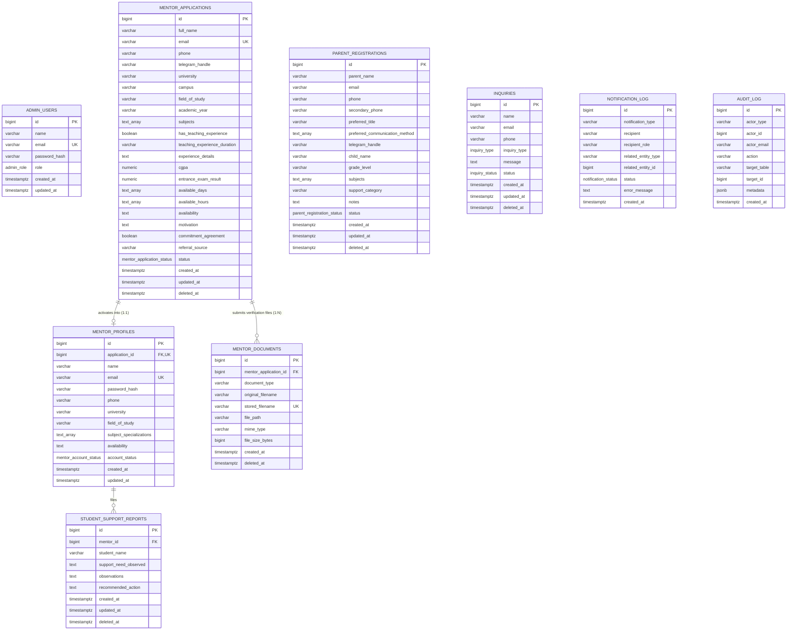

# Bilunex Database Architecture & Schema Specification (Version 1)

This document provides the definitive technical specification for the Bilunex PostgreSQL database architecture, migrations, security controls, and operational query patterns.

---

## 1. Entity-Relationship Diagram (ERD)



### Relationship Breakdown

1. **`mentor_applications` &rarr; `mentor_profiles` (1:1 optional)**:
   - An applicant applies via public submission.
   - When screening passes and status reaches `'accepted'`, an administrator activates the mentor account.
   - `mentor_profiles.application_id` has a `UNIQUE` foreign key constraint referencing `mentor_applications(id)` with `ON DELETE RESTRICT`.
2. **`mentor_profiles` &rarr; `student_support_reports` (1:N)**:
   - Mentors submit session summaries.
   - `student_support_reports.mentor_id` references `mentor_profiles(id)` with `ON DELETE RESTRICT`.
   - Mentors may strictly query reports where `mentor_id` matches their own profile ID.
3. **`parent_registrations` & `inquiries` (Independent intake)**:
   - Public entries that stand independently.
4. **`notification_log` & `audit_log` (System-wide Observability)**:
   - `notification_log` captures every email dispatch without foreign key blocking.
   - `audit_log` tracks access and modifications to sensitive student and parent data.

---

## 2. Enumeration Types (Enums)

| Enum Name                    | Allowed Values                                                                                              | Usage                                                                                             |
| ---------------------------- | ----------------------------------------------------------------------------------------------------------- | ------------------------------------------------------------------------------------------------- |
| `admin_role`                 | `'super_admin'`, `'admin'`                                                                                  | Staff access levels on `admin_users`.                                                             |
| `mentor_application_status`  | `'application_received'`, `'under_review'`, `'interview_stage'`, `'accepted'`, `'rejected'`, `'onboarding'` | 6-stage candidate screening pipeline on `mentor_applications`. Default: `'application_received'`. |
| `mentor_account_status`      | `'active'`, `'inactive'`, `'suspended'`                                                                     | Login authorization on `mentor_profiles`. Default: `'active'`.                                    |
| `parent_registration_status` | `'new'`, `'contacted'`, `'enrolled'`, `'archived'`                                                          | Student intake workflow on `parent_registrations`. Default: `'new'`.                              |
| `inquiry_type`               | `'general'`, `'parent_support'`, `'mentor_application'`, `'counseling'`                                     | Categorization of public contact inquiries.                                                       |
| `inquiry_status`             | `'new'`, `'in_progress'`, `'resolved'`, `'archived'`                                                        | Support ticket lifecycle on `inquiries`. Default: `'new'`.                                        |
| `notification_status`        | `'success'`, `'failure'`                                                                                    | Delivery outcome on `notification_log`.                                                           |

---

## 3. Detailed Table Specifications

### 3.1 `admin_users`

Stores administrative staff identities and credentials.

| Column          | Type           | Constraints & Defaults                           | Description                         |
| --------------- | -------------- | ------------------------------------------------ | ----------------------------------- |
| `id`            | `BIGINT`       | `GENERATED ALWAYS AS IDENTITY PRIMARY KEY`       | Sequential primary key              |
| `name`          | `VARCHAR(255)` | `NOT NULL`, `CHECK(length(trim(name)) > 0)`      | Staff member's full name            |
| `email`         | `VARCHAR(255)` | `NOT NULL`, regex check, `UNIQUE(LOWER(email))`  | Case-insensitive unique login email |
| `password_hash` | `VARCHAR(255)` | `NOT NULL`, `CHECK(length(password_hash) >= 20)` | Bcrypt hash (salt factor 10+)       |
| `role`          | `admin_role`   | `NOT NULL DEFAULT 'admin'`                       | Administrative permission tier      |
| `created_at`    | `TIMESTAMPTZ`  | `NOT NULL DEFAULT CURRENT_TIMESTAMP`             | Record creation timestamp           |
| `updated_at`    | `TIMESTAMPTZ`  | `NOT NULL DEFAULT CURRENT_TIMESTAMP`             | Trigger-maintained timestamp        |

### 3.2 `mentor_applications`

Stores candidate mentor submissions throughout the screening pipeline.

| Column            | Type                        | Constraints & Defaults                                                   | Description                             |
| ----------------- | --------------------------- | ------------------------------------------------------------------------ | --------------------------------------- |
| `id`              | `BIGINT`                    | `GENERATED ALWAYS AS IDENTITY PRIMARY KEY`                               | Sequential primary key                  |
| `full_name`       | `VARCHAR(255)`              | `NOT NULL`, non-empty check                                              | Applicant's full name                   |
| `email`           | `VARCHAR(255)`              | `NOT NULL`, regex check, `UNIQUE(LOWER(email)) WHERE deleted_at IS NULL` | Candidate contact email                 |
| `phone`           | `VARCHAR(50)`               | `NOT NULL`, non-empty check                                              | Phone contact number                    |
| `telegram_handle` | `VARCHAR(100)`              | `NULLABLE`                                                               | Optional Telegram handle                |
| `university`      | `VARCHAR(255)`              | `NOT NULL`, non-empty check                                              | College / University affiliation        |
| `field_of_study`  | `VARCHAR(255)`              | `NOT NULL`, non-empty check                                              | Degree / Major                          |
| `academic_year`   | `VARCHAR(100)`              | `NOT NULL`, non-empty check                                              | Year of study (e.g. 3rd Year, Graduate) |
| `subjects`        | `TEXT[]`                    | `NOT NULL`, `CHECK(array_length(subjects, 1) > 0)`                       | Array of subjects mentor can teach      |
| `availability`    | `TEXT`                      | `NOT NULL`, non-empty check                                              | Weekly time slots and hour commitments  |
| `motivation`      | `TEXT`                      | `NOT NULL`, non-empty check                                              | Statement of intent & background        |
| `status`          | `mentor_application_status` | `NOT NULL DEFAULT 'application_received'`                                | Candidate screening stage               |
| `created_at`      | `TIMESTAMPTZ`               | `NOT NULL DEFAULT CURRENT_TIMESTAMP`                                     | Application submission date             |
| `updated_at`      | `TIMESTAMPTZ`               | `NOT NULL DEFAULT CURRENT_TIMESTAMP`                                     | Trigger-maintained timestamp            |
| `deleted_at`      | `TIMESTAMPTZ`               | `DEFAULT NULL`                                                           | Soft delete marker                      |

### 3.3 `mentor_profiles`

Stores verified, active mentors who have passed screening and have portal credentials.

| Column                    | Type                    | Constraints & Defaults                                                  | Description                        |
| ------------------------- | ----------------------- | ----------------------------------------------------------------------- | ---------------------------------- |
| `id`                      | `BIGINT`                | `GENERATED ALWAYS AS IDENTITY PRIMARY KEY`                              | Sequential primary key             |
| `application_id`          | `BIGINT`                | `UNIQUE NOT NULL REFERENCES mentor_applications(id) ON DELETE RESTRICT` | Link back to screening application |
| `name`                    | `VARCHAR(255)`          | `NOT NULL`, non-empty check                                             | Mentor's display name              |
| `email`                   | `VARCHAR(255)`          | `NOT NULL`, regex check, `UNIQUE(LOWER(email))`                         | Portal login email                 |
| `password_hash`           | `VARCHAR(255)`          | `NOT NULL`, `CHECK(length(password_hash) >= 20)`                        | Bcrypt hash                        |
| `phone`                   | `VARCHAR(50)`           | `NULLABLE`                                                              | Direct contact phone               |
| `university`              | `VARCHAR(255)`          | `NOT NULL`                                                              | Verified university                |
| `field_of_study`          | `VARCHAR(255)`          | `NOT NULL`                                                              | Verified major                     |
| `subject_specializations` | `TEXT[]`                | `NOT NULL`, non-empty array                                             | Assigned subject specializations   |
| `availability`            | `TEXT`                  | `NOT NULL`                                                              | Confirmed working schedule         |
| `account_status`          | `mentor_account_status` | `NOT NULL DEFAULT 'active'`                                             | Access authorization status        |
| `created_at`              | `TIMESTAMPTZ`           | `NOT NULL DEFAULT CURRENT_TIMESTAMP`                                    | Account activation date            |
| `updated_at`              | `TIMESTAMPTZ`           | `NOT NULL DEFAULT CURRENT_TIMESTAMP`                                    | Trigger-maintained timestamp       |

### 3.4 `parent_registrations`

Intake submissions from parents requesting tutoring, mentoring, or counseling.

| Column             | Type                         | Constraints & Defaults                     | Description                               |
| ------------------ | ---------------------------- | ------------------------------------------ | ----------------------------------------- |
| `id`               | `BIGINT`                     | `GENERATED ALWAYS AS IDENTITY PRIMARY KEY` | Sequential primary key                    |
| `parent_name`      | `VARCHAR(255)`               | `NOT NULL`, non-empty check                | Parent / Guardian full name               |
| `email`            | `VARCHAR(255)`               | `NOT NULL`, regex check                    | Parent contact email                      |
| `phone`            | `VARCHAR(50)`                | `NOT NULL`, non-empty check                | Parent primary telephone                  |
| `telegram_handle`  | `VARCHAR(100)`               | `NULLABLE`                                 | Optional Telegram handle                  |
| `child_name`       | `VARCHAR(255)`               | `NOT NULL`, non-empty check                | Student / Child full name [SENSITIVE]     |
| `grade_level`      | `VARCHAR(100)`               | `NOT NULL`, non-empty check                | School grade level                        |
| `subjects`         | `TEXT[]`                     | `NOT NULL DEFAULT '{}'`                    | Array of subjects needing support         |
| `support_category` | `VARCHAR(50)`                | `NOT NULL DEFAULT 'combined'`              | Category: tutoring, mentoring, counseling |
| `notes`            | `TEXT`                       | `NULLABLE`                                 | Context, strengths, and specific needs    |
| `status`           | `parent_registration_status` | `NOT NULL DEFAULT 'new'`                   | Intake progression status                 |
| `created_at`       | `TIMESTAMPTZ`                | `NOT NULL DEFAULT CURRENT_TIMESTAMP`       | Intake submission date                    |
| `updated_at`       | `TIMESTAMPTZ`                | `NOT NULL DEFAULT CURRENT_TIMESTAMP`       | Trigger-maintained timestamp              |
| `deleted_at`       | `TIMESTAMPTZ`                | `DEFAULT NULL`                             | Soft delete marker                        |

### 3.5 `student_support_reports`

Confidential observations and recommendations submitted by mentors following support sessions. Visible only to administrators and the reporting mentor.

| Column                  | Type           | Constraints & Defaults                                       | Description                                 |
| ----------------------- | -------------- | ------------------------------------------------------------ | ------------------------------------------- |
| `id`                    | `BIGINT`       | `GENERATED ALWAYS AS IDENTITY PRIMARY KEY`                   | Sequential primary key                      |
| `mentor_id`             | `BIGINT`       | `NOT NULL REFERENCES mentor_profiles(id) ON DELETE RESTRICT` | Authoring mentor                            |
| `student_name`          | `VARCHAR(255)` | `NOT NULL`, non-empty check                                  | Student name [SENSITIVE]                    |
| `support_need_observed` | `TEXT`         | `NOT NULL`, non-empty check                                  | Specific academic/emotional hurdle observed |
| `observations`          | `TEXT`         | `NOT NULL`, non-empty check                                  | Session observations & engagement notes     |
| `recommended_action`    | `TEXT`         | `NOT NULL`, non-empty check                                  | Assigned homework & next steps              |
| `created_at`            | `TIMESTAMPTZ`  | `NOT NULL DEFAULT CURRENT_TIMESTAMP`                         | Report filing timestamp                     |
| `updated_at`            | `TIMESTAMPTZ`  | `NOT NULL DEFAULT CURRENT_TIMESTAMP`                         | Trigger-maintained timestamp                |
| `deleted_at`            | `TIMESTAMPTZ`  | `DEFAULT NULL`                                               | Soft delete marker                          |

### 3.6 `inquiries`

General public messages, counseling inquiries, and volunteer inquiries.

| Column         | Type             | Constraints & Defaults                     | Description                  |
| -------------- | ---------------- | ------------------------------------------ | ---------------------------- |
| `id`           | `BIGINT`         | `GENERATED ALWAYS AS IDENTITY PRIMARY KEY` | Sequential primary key       |
| `name`         | `VARCHAR(255)`   | `NOT NULL`, non-empty check                | Inquirer's full name         |
| `email`        | `VARCHAR(255)`   | `NOT NULL`, regex check                    | Inquirer's contact email     |
| `phone`        | `VARCHAR(50)`    | `NULLABLE`                                 | Contact telephone            |
| `inquiry_type` | `inquiry_type`   | `NOT NULL DEFAULT 'general'`               | Inquiry category             |
| `message`      | `TEXT`           | `NOT NULL`, non-empty check                | Message content              |
| `status`       | `inquiry_status` | `NOT NULL DEFAULT 'new'`                   | Resolution status            |
| `created_at`   | `TIMESTAMPTZ`    | `NOT NULL DEFAULT CURRENT_TIMESTAMP`       | Submission timestamp         |
| `updated_at`   | `TIMESTAMPTZ`    | `NOT NULL DEFAULT CURRENT_TIMESTAMP`       | Trigger-maintained timestamp |
| `deleted_at`   | `TIMESTAMPTZ`    | `DEFAULT NULL`                             | Soft delete marker           |

### 3.7 `notification_log`

Audit history of all dispatched emails and notifications.

| Column                | Type                  | Constraints & Defaults                     | Description                      |
| --------------------- | --------------------- | ------------------------------------------ | -------------------------------- |
| `id`                  | `BIGINT`              | `GENERATED ALWAYS AS IDENTITY PRIMARY KEY` | Sequential primary key           |
| `notification_type`   | `VARCHAR(100)`        | `NOT NULL`, non-empty check                | e.g. `'parent_registration_ack'` |
| `recipient`           | `VARCHAR(255)`        | `NOT NULL`, non-empty check                | Destination email address        |
| `related_entity_type` | `VARCHAR(100)`        | `NULLABLE`                                 | Associated table name            |
| `related_entity_id`   | `BIGINT`              | `NULLABLE`                                 | Associated record ID             |
| `status`              | `notification_status` | `NOT NULL DEFAULT 'success'`               | `'success'` or `'failure'`       |
| `error_message`       | `TEXT`                | `NULLABLE`                                 | SMTP error details if failed     |
| `created_at`          | `TIMESTAMPTZ`         | `NOT NULL DEFAULT CURRENT_TIMESTAMP`       | Dispatch timestamp               |

### 3.8 `audit_log`

Immutable tracking log recording access and mutations to sensitive records.

| Column         | Type           | Constraints & Defaults                                                                            | Description                             |
| -------------- | -------------- | ------------------------------------------------------------------------------------------------- | --------------------------------------- |
| `id`           | `BIGINT`       | `GENERATED ALWAYS AS IDENTITY PRIMARY KEY`                                                        | Sequential primary key                  |
| `actor_type`   | `VARCHAR(50)`  | `NOT NULL CHECK(actor_type IN ('admin', 'mentor', 'system'))`                                     | Initiator category                      |
| `actor_id`     | `BIGINT`       | `NULLABLE`                                                                                        | Initiator ID                            |
| `actor_email`  | `VARCHAR(255)` | `NULLABLE`                                                                                        | Initiator email                         |
| `action`       | `VARCHAR(50)`  | `NOT NULL CHECK(action IN ('view', 'create', 'update', 'delete', 'activate', 'login', 'export'))` | Action executed                         |
| `target_table` | `VARCHAR(100)` | `NOT NULL`, non-empty check                                                                       | Target table modified/viewed            |
| `target_id`    | `BIGINT`       | `NULLABLE`                                                                                        | Target record primary key               |
| `metadata`     | `JSONB`        | `DEFAULT '{}'::jsonb`                                                                             | Additional context (IP, diffs, filters) |
| `created_at`   | `TIMESTAMPTZ`  | `NOT NULL DEFAULT CURRENT_TIMESTAMP`                                                              | Action timestamp                        |

---

### 3.9 `stories`

Private story submissions are pending by default. Only the approved public projection is returned by the public repository; full name, email, phone and consent details are excluded.

| Column                                   | Type                    | Constraints                                           |
| ---------------------------------------- | ----------------------- | ----------------------------------------------------- |
| `full_name`                              | `VARCHAR(255)`          | Required; admin-only/private                          |
| `display_style`                          | `VARCHAR(20)`           | `first_name`, `initials`, or `anonymous`              |
| `relationship`                           | `VARCHAR(30)`           | `parent_guardian`, `student`, `mentor`, or `other`    |
| `email`, `phone`                         | `VARCHAR`               | Optional, private follow-up details                   |
| `title`                                  | `VARCHAR(160)`          | Required                                              |
| `body`                                   | `TEXT`                  | 50–2000 characters                                    |
| `consent_*`                              | `BOOLEAN`               | All required and true; matching timestamps are stored |
| `status`                                 | `VARCHAR(20)`           | `pending`, `approved`, or `rejected`                  |
| `reviewed_by`, `reviewed_at`             | `BIGINT`, `TIMESTAMPTZ` | Admin and moderation timestamp                        |
| `published_at`                           | `TIMESTAMPTZ`           | Set on approval                                       |
| `deleted_at`, `created_at`, `updated_at` | `TIMESTAMPTZ`           | Soft-delete and lifecycle timestamps                  |

Migration `017_stories` creates this table and partial status/publication indexes. No public stories are seeded.

## 4. Privacy, Children's Data & Security Guidelines

### 4.1 Sensitive Data Classification

| Entity                           | Sensitive Column                        | Risk Level                  | Protection Controls                                                             |
| -------------------------------- | --------------------------------------- | --------------------------- | ------------------------------------------------------------------------------- |
| `parent_registrations`           | `child_name`                            | **High (PII - Minor)**      | Admin-only access, audit log on export/view, partial index on lowercase.        |
| `parent_registrations`           | `parent_name`, `email`, `phone`         | **Medium (PII)**            | Encrypted in transit (TLS), rate-limited form submissions.                      |
| `student_support_reports`        | `student_name`                          | **High (PII - Minor)**      | Restricted to assigned mentor and admins. Never exposed in public endpoints.    |
| `student_support_reports`        | `support_need_observed`, `observations` | **High (Special Category)** | Detailed observations regarding student emotional state. Strictly confidential. |
| `admin_users`, `mentor_profiles` | `password_hash`                         | **High (Credentials)**      | Bcrypt hash with salt factor 10. Minimum length constraint enforced.            |

### 4.2 Student Name Encryption Recommendation

- **Current Approach**: In Version 1, student names are stored as plaintext `VARCHAR(255)` with strict row-level application filters and database role restrictions.
- **Trade-Off Analysis**:
  - Encrypting `student_name` at the database column level via `pgcrypto` (`pgp_sym_encrypt`) requires a shared secret key in SQL queries and disables `ILIKE` wildcard substring searches (`WHERE student_name ILIKE '%alex%'`).
  - Searchable symmetric encryption (SSE) or deterministic blind indexing adds significant maintenance complexity for a beginner-maintained project.
- **Recommendation**:
  - Protect children's data at rest via PostgreSQL transparent disk encryption (LUKS / encrypted storage volume).
  - Enforce strict application-level role authorization: mentors can only retrieve records with `WHERE mentor_id = $1`.
  - Log all administrative views of student records in `audit_log`.

### 4.3 Least-Privilege Application Database Role

In production, the application should never connect as the `postgres` superuser. Run the following SQL to provision the restricted `bilunex_app` runtime role:

```sql
-- 1. Create dedicated application user
CREATE USER bilunex_app WITH PASSWORD 'secure_application_password_here';

-- 2. Connect to bilunex database
\c bilunex

-- 3. Revoke default public schema privileges
REVOKE CREATE ON SCHEMA public FROM PUBLIC;

-- 4. Grant connection and schema usage
GRANT CONNECT ON DATABASE bilunex TO bilunex_app;
GRANT USAGE ON SCHEMA public TO bilunex_app;

-- 5. Grant CRUD permissions on all application tables (NO DROP / ALTER)
GRANT SELECT, INSERT, UPDATE, DELETE ON ALL TABLES IN SCHEMA public TO bilunex_app;

-- 6. Grant sequence usage for identity columns
GRANT USAGE, SELECT ON ALL SEQUENCES IN SCHEMA public TO bilunex_app;

-- 7. Ensure future tables created by migrations inherit permissions
ALTER DEFAULT PRIVILEGES IN SCHEMA public
GRANT SELECT, INSERT, UPDATE, DELETE ON TABLES TO bilunex_app;

ALTER DEFAULT PRIVILEGES IN SCHEMA public
GRANT USAGE, SELECT ON SEQUENCES TO bilunex_app;
```

### 4.4 Data Retention and Backup Strategy

1. **Soft Delete Retention**: Records marked with `deleted_at` are retained for **12 months** to allow safeguarding review and dispute resolution.
2. **Purge Policy**: A quarterly retention job purges records where `deleted_at < CURRENT_TIMESTAMP - INTERVAL '1 year'`.
3. **Backup Routine**: Daily compressed dump using `pg_dump`:
   ```bash
   pg_dump -Fc -h localhost -U bilunex_user bilunex > /backup/bilunex_$(date +%Y%m%d_%H%M%S).dump
   ```
   Backups should be stored on encrypted offsite storage with a 30-day retention policy.

---

## 5. Six Example Administrative SQL Queries

Below are the 6 standard administrative queries for Bilunex operations. These queries should be executed through repository methods.

### Query 1: Search and Filter Parent Registrations

Filters active parent registrations by status, grade level, subject containment, date range, and case-insensitive name/email search.

```sql
SELECT
  id,
  parent_name,
  email,
  phone,
  telegram_handle,
  child_name,
  grade_level,
  subjects,
  support_category,
  notes,
  status,
  created_at
FROM parent_registrations
WHERE deleted_at IS NULL
  AND ($1::parent_registration_status IS NULL OR status = $1)
  AND ($2::varchar IS NULL OR grade_level = $2)
  AND ($3::varchar IS NULL OR $3 = ANY(subjects))
  AND ($4::timestamptz IS NULL OR created_at >= $4)
  AND ($5::varchar IS NULL OR (
      parent_name ILIKE '%' || $5 || '%'
      OR child_name ILIKE '%' || $5 || '%'
      OR email ILIKE '%' || $5 || '%'
  ))
ORDER BY created_at DESC
LIMIT 50 OFFSET 0;
```

### Query 2: Count Mentor Applications Grouped by Status

Aggregates candidate volume across each stage of the 6-stage screening pipeline.

```sql
SELECT
  status,
  COUNT(*)::int AS count
FROM mentor_applications
WHERE deleted_at IS NULL
GROUP BY status
ORDER BY
  CASE status
    WHEN 'application_received' THEN 1
    WHEN 'under_review'        THEN 2
    WHEN 'interview_stage'     THEN 3
    WHEN 'accepted'            THEN 4
    WHEN 'onboarding'          THEN 5
    WHEN 'rejected'            THEN 6
  END;
```

### Query 3: Update Mentor Application Status

Advances an applicant to the next screening stage while updating timestamps.

```sql
UPDATE mentor_applications
SET
  status = $1::mentor_application_status,
  updated_at = CURRENT_TIMESTAMP
WHERE id = $2
  AND deleted_at IS NULL
RETURNING
  id,
  full_name,
  email,
  status,
  updated_at;
```

### Query 4: Activate a Mentor from an Accepted Application (Transaction)

Executed in a database transaction when an admin approves an applicant: creates the `mentor_profiles` credential record, updates the application status to `'onboarding'`, and inserts an audit log.

```sql
BEGIN;

-- Step 1: Insert mentor profile linked to application
INSERT INTO mentor_profiles (
  application_id,
  name,
  email,
  password_hash,
  phone,
  university,
  field_of_study,
  subject_specializations,
  availability,
  account_status
)
SELECT
  id,
  full_name,
  email,
  $1, -- Temporarily generated bcrypt hash or initial credentials
  phone,
  university,
  field_of_study,
  subjects,
  availability,
  'active'
FROM mentor_applications
WHERE id = $2
  AND status = 'accepted'
  AND deleted_at IS NULL
RETURNING id, name, email, account_status;

-- Step 2: Update application status to onboarding
UPDATE mentor_applications
SET
  status = 'onboarding',
  updated_at = CURRENT_TIMESTAMP
WHERE id = $2;

-- Step 3: Record audit log entry
INSERT INTO audit_log (
  actor_type,
  actor_id,
  actor_email,
  action,
  target_table,
  target_id,
  metadata
)
VALUES (
  'admin',
  $3, -- Admin user ID
  $4, -- Admin email
  'activate',
  'mentor_profiles',
  (SELECT id FROM mentor_profiles WHERE application_id = $2),
  jsonb_build_object('application_id', $2, 'activated_at', CURRENT_TIMESTAMP)
);

COMMIT;
```

### Query 5: List Student Support Reports with Mentor Names

Chronological audit feed for administrators inspecting session observations across all mentors.

```sql
SELECT
  r.id AS report_id,
  r.student_name,
  r.support_need_observed,
  r.observations,
  r.recommended_action,
  r.created_at AS report_date,
  m.id AS mentor_id,
  m.name AS mentor_name,
  m.email AS mentor_email,
  m.university AS mentor_university
FROM student_support_reports r
JOIN mentor_profiles m ON m.id = r.mentor_id
WHERE r.deleted_at IS NULL
ORDER BY r.created_at DESC
LIMIT 100 OFFSET 0;
```

### Query 6: Insert an Audit Log Entry

Logs every access or modification of sensitive child, parent, or mentor records.

```sql
INSERT INTO audit_log (
  actor_type,
  actor_id,
  actor_email,
  action,
  target_table,
  target_id,
  metadata
)
VALUES (
  $1::varchar, -- 'admin' or 'mentor'
  $2::bigint,  -- Actor user ID
  $3::varchar, -- Actor email
  $4::varchar, -- 'view', 'create', 'update', 'delete', 'activate', 'export'
  $5::varchar, -- e.g. 'parent_registrations', 'student_support_reports'
  $6::bigint,  -- Target row primary key
  $7::jsonb    -- jsonb_build_object('ip', $8, 'reason', $9)
)
RETURNING id, created_at;
```

---

## 6. Migration & Seed Operations

All migration commands are executed through the Node.js runner scripts inside `server/`:

| Operation                      | Command                | Action                                                                                       |
| ------------------------------ | ---------------------- | -------------------------------------------------------------------------------------------- |
| **Run Migrations (UP)**        | `npm run migrate`      | Executes all `*.up.sql` files sequentially in ascending order (`001` &rarr; `014`).          |
| **Rollback Migrations (DOWN)** | `npm run migrate:down` | Executes all `*.down.sql` files sequentially in descending order (`014` &rarr; `001`).       |
| **Seed Development Data**      | `npm run seed`         | Populates default admin, sample mentors, parents, reports, and logs. Blocked in production.  |
| **Reset Database**             | `npm run db:reset`     | Reverts all migrations (`DOWN`), re-applies all migrations (`UP`), and seeds fresh fixtures. |

### Complete Migrations Sequence

1. `001_extensions_and_helpers.up.sql`: Loads `pg_trgm` extension for fuzzy text search.
2. `002_enums.up.sql`: Declares PostgreSQL enum types (`admin_role`, `mentor_application_status`, `mentor_account_status`, `parent_registration_status`, `inquiry_type`, `inquiry_status`, `notification_status`).
3. `003_admin_users.up.sql`: Creates `admin_users` table with bcrypt password storage.
4. `004_mentor_applications.up.sql`: Creates initial candidate mentor application pipeline.
5. `005_mentor_profiles.up.sql`: Creates verified mentor profile records linked 1:1 to applications.
6. `006_parent_registrations.up.sql`: Creates student intake table with contact and academic need fields.
7. `007_student_support_reports.up.sql`: Creates mentor session observation reports.
8. `008_inquiries.up.sql`: Creates public contact and counseling inquiries table.
9. `009_logs.up.sql`: Creates immutable `audit_log` and non-blocking `notification_log`.
10. `010_indexes.up.sql`: Creates search, filtering, and foreign key indexes.
11. `011_parent_registration_fields.up.sql`: Adds `preferred_title`, `secondary_phone`, and `preferred_communication_method` array to `parent_registrations`.
12. `012_mentor_application_fields.up.sql`: Adds `campus`, teaching experience details, CGPA, EHEEE score, stream-specific score limits, availability schedule, and commitment agreement to `mentor_applications`.
13. `013_mentor_documents.up.sql`: Creates `mentor_documents` table for secure file upload tracking.
14. `014_notification_log_fields.up.sql`: Adds `recipient_role` and failure query index to `notification_log`.
15. `015_notification_delivery_statuses.up.sql`: Adds offline and timeout notification statuses.
16. `016_mentor_application_requirements.up.sql`: Renames GPA to CGPA, adds entrance exam stream limits, and converts available hours to validated selections.
17. `017_stories.up.sql`: Adds private story submissions and partial moderation/publication indexes.

---

## 7. Data Protection, Document Security & Retention Policy

### 7.1 Confidential Document Security

Candidate academic transcripts and identification photos are treated as restricted personal data:

- **Binary Signature Verification**: Uploads are inspected for magic byte headers (`%PDF-`, JPEG `0xFF, 0xD8, 0xFF`, PNG `0x89, 0x50, 0x4E, 0x47`) to prevent malicious executable injection and MIME spoofing.
- **Private Storage**: Documents are persisted outside the public web root in `server/storage/private/documents/` (directory permission `0700`, file permission `0600`) under randomly generated UUID filenames (`crypto.randomUUID()`).
- **Zero Static Serving**: The storage directory is never exposed via static web middleware.
- **Audited Streaming**: Documents can only be retrieved by authenticated administrators via `GET /api/v1/admin/documents/:id/download`. Every download access is immutably recorded in `audit_log` (`action: 'view'`, `target_table: 'mentor_documents'`).

### 7.2 Document Retention Policy

- **Active Candidates**: Transcripts and identification photos are retained during the screening, interview, and active onboarding stages.
- **Rejected Applications**: Candidate transcripts and photos are retained for a maximum of **30 days** following application rejection or withdrawal to facilitate administrative audit, after which file binaries are permanently purged from secure disk storage and marked soft-deleted (`deleted_at = CURRENT_TIMESTAMP`).
- **Enrolled Mentors**: Following successful screening and account activation, candidate verification records remain securely archived in compliance with educational accreditation standards.
